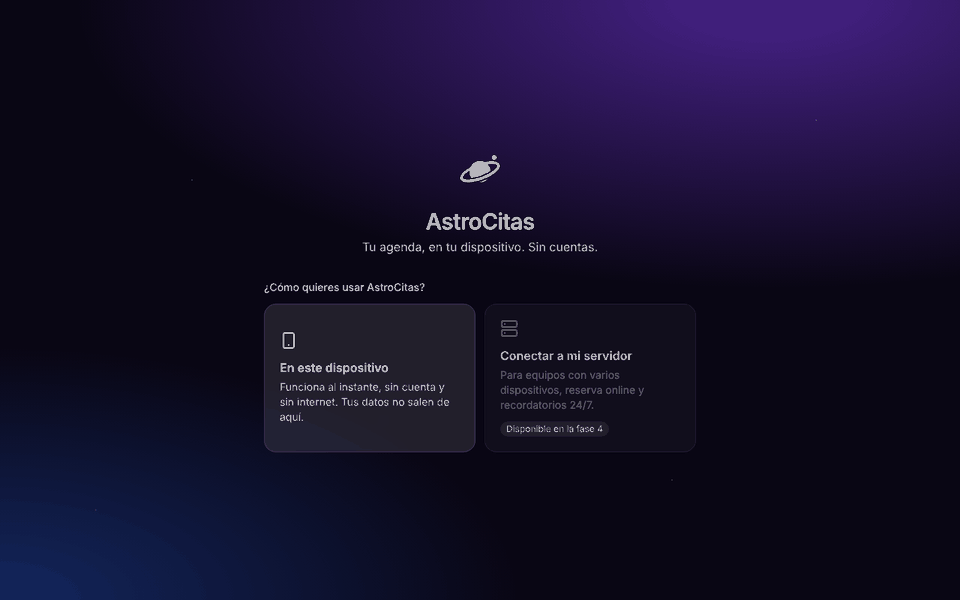
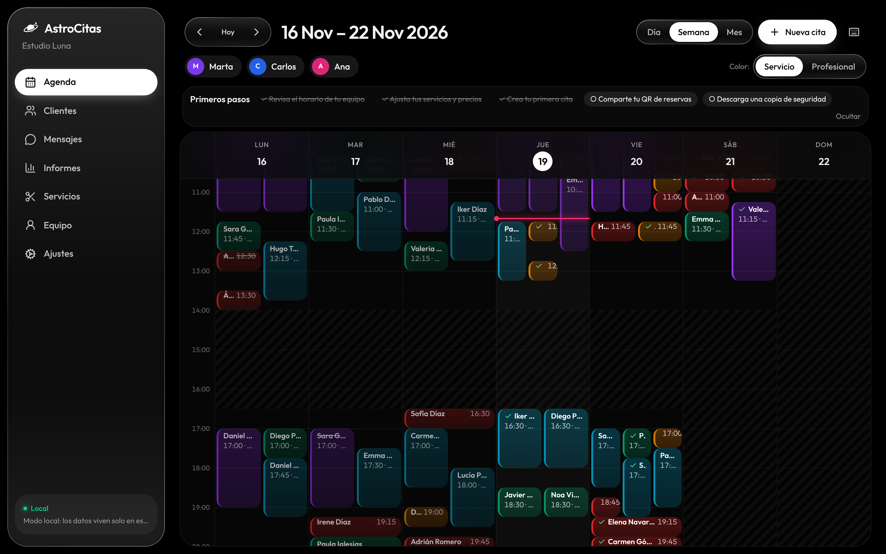
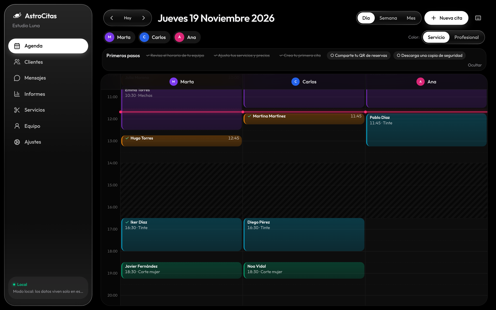
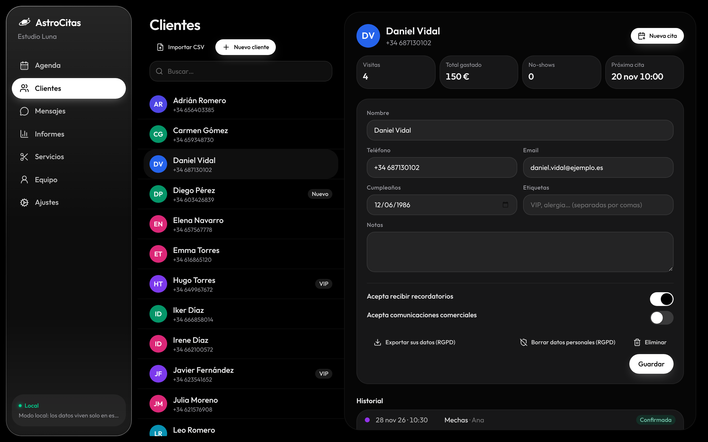
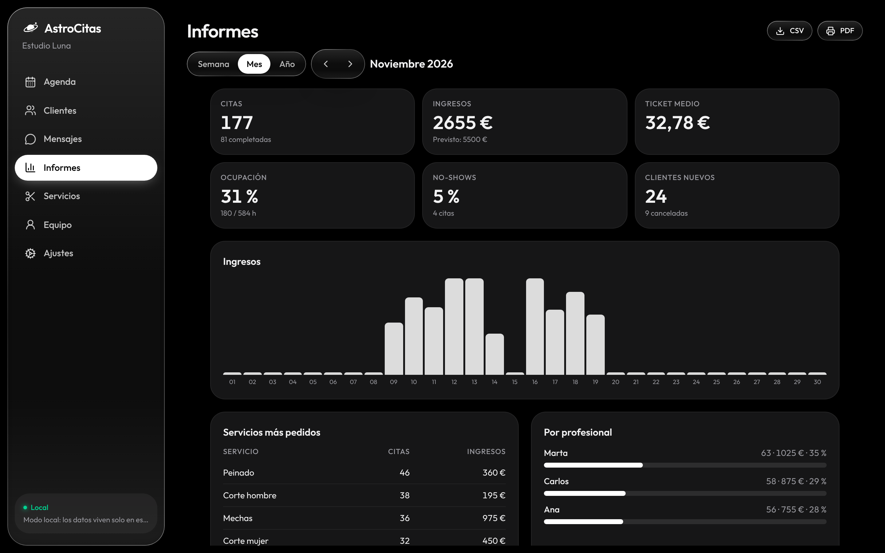
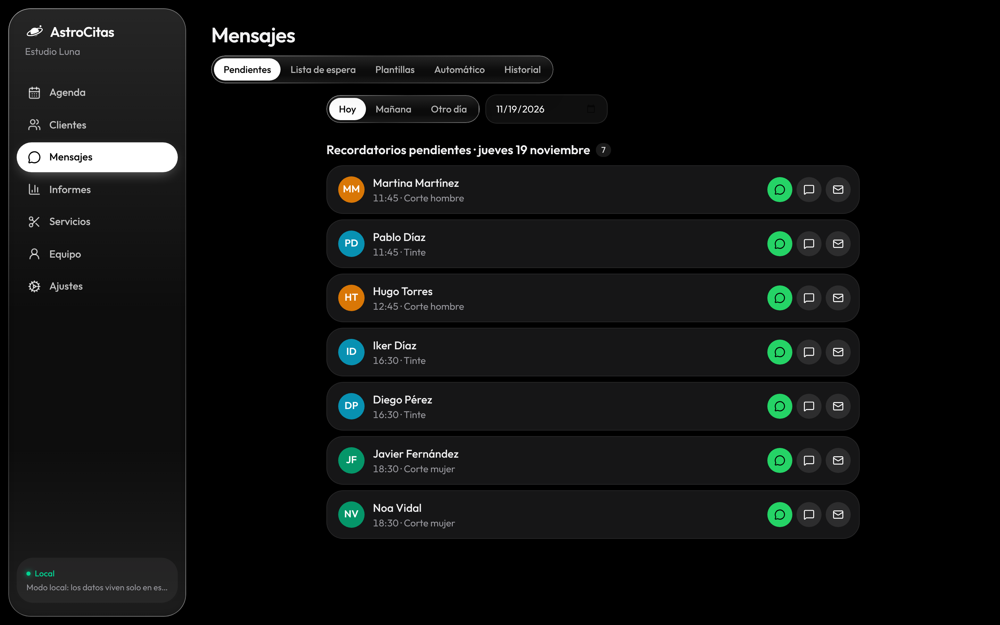
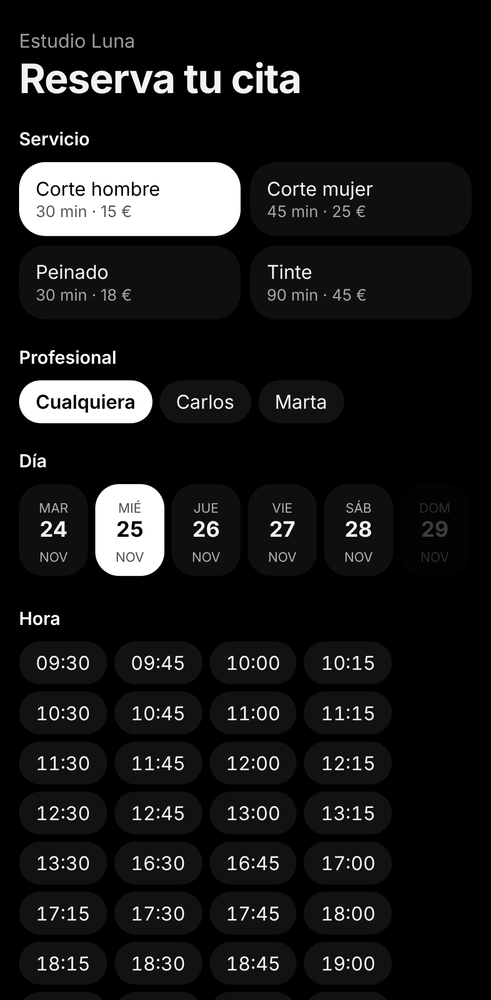
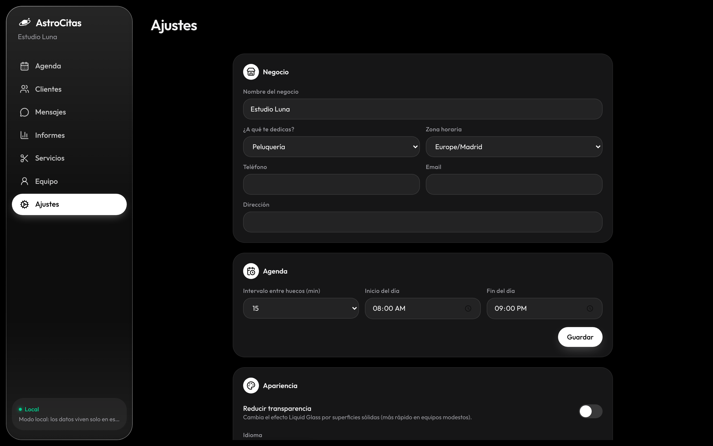

<p align="center">
  <picture>
    <source media="(prefers-color-scheme: dark)" srcset="assets/brand/logo-white.svg">
    
  </picture>
</p>

<p align="center">
  <strong>Agenda de citas con recordatorios para negocios de servicios y autónomos.</strong><br>
  Local-first · Open source · Sin cuentas · Tus datos, tu dispositivo, tu servidor.
</p>

<p align="center">
  <a href="../../releases/latest"></a>
  <a href="LICENSE"></a>
  
</p>

<p align="center">
  
</p>

Peluquerías, barberías, clínicas, fisios, centros de estética, talleres, academias… AstroCitas es una
agenda **bonita, rápida y usable sin formación**. No hay servicio en la nube del autor, ni planes, ni pagos,
ni cuentas centrales. Funciona de dos formas con **el mismo código y la misma interfaz**:

- **A) Local**: instalas y funciona al instante, sin cuenta, sin internet y sin servidor. Los datos viven en tu dispositivo.
- **B) Autohospedado**: montas tu propio servidor con Docker (un comando) y tus apps se conectan a él.
  Sigue funcionando sin conexión y sincroniza solo.

## Capturas

| Semana | Día por profesional |
|---|---|
|  |  |
| **Nueva cita en 3 toques** (servicio → hueco → cliente) | **Ficha de cliente** con historial, gasto y fidelidad |
|  |  |
| **Informes** | **Recordatorios en 1 toque** |
|  |  |
| **Reserva online** (servidor propio) | **Ajustes** |
|  |  |

<p align="center">
  
  
</p>

## Descargas

Todas en **[GitHub Releases](../../releases/latest)**, con `SHA256SUMS.txt` para verificar la integridad.

| Plataforma | Archivo |
|---|---|
| 🪟 Windows | `AstroCitas_X.Y.Z_x64_es-ES.msi`, `…_x64-setup.exe` o `…_x64-portable.exe` (sin instalar) |
| 🍎 macOS (Intel + Apple Silicon) | `AstroCitas_X.Y.Z_universal.dmg` |
| 🐧 Linux | `.AppImage` (cualquier distro), `.deb` (Debian/Ubuntu), `.rpm` (Fedora/openSUSE) |
| 🤖 Android | `AstroCitas_X.Y.Z_android-universal.apk` (instalación directa) · `.aab` (Play Store) |
| 🌐 Web (PWA) | `astrocitas-web-X.Y.Z.zip`: súbelo a cualquier hosting estático; instalable desde el navegador |
| 🐳 Servidor | `docker pull ghcr.io/astrosoftwaremoon/astrocitas-server:latest` (amd64 / arm64) |
| 📱 iOS | Proyecto y workflow preparados; requiere cuenta de Apple Developer ([docs/IOS.md](docs/IOS.md)) |

La app de escritorio se **autoactualiza** con actualizaciones firmadas.

## Instalación

### Modo A · Local (sin nada)

1. Abre la app (escritorio, Android o web) y elige **«En este dispositivo»**.
2. Escribe el nombre del negocio, el tipo y quién atiende. Si quieres, carga datos de ejemplo.
3. Listo. Sin registro y sin internet.

Los datos se guardan en SQLite en el propio dispositivo:

- **En escritorio y Android**, con cifrado opcional por contraseña (SQLCipher).
- **En la web**, en el almacenamiento privado del navegador (OPFS).

Haz copias en **Ajustes → Tus datos**: archivo `.astrocitas`, opcionalmente cifrado. Además se hace una copia automática diaria.

### Modo B · Autohospedado

```bash
curl -fsSL https://github.com/AstroSoftwareMoon/AstroCitas/releases/latest/download/install.sh | sh
```

Instala Docker si hace falta y arranca AstroCitas con **Caddy** (HTTPS automático). **¿Sin dominio?** Pulsa Intro: usa la IP de tu equipo y te dice la dirección exacta (p. ej. `http://192.168.1.40`) para la app, el móvil y el iPhone.

**Desde la app de escritorio, sin terminal:** *Ajustes → Servidor en este ordenador → Instalar* (usa Docker Desktop). Instala el servidor, te muestra la dirección y un QR para el móvil y conecta la app sola. Después, en la app: **Conectar a mi servidor** → URL + usuario. El asistente comprueba la versión y te ofrece subir tus datos locales.
Guía completa para **VPS, Raspberry Pi y NAS**, PostgreSQL/Redis opcionales, WhatsApp y copias: **[docs/SELFHOSTING.md](docs/SELFHOSTING.md)**.

## Funcionalidades

**Agenda**
- Vistas día, semana y mes. Colores por profesional o servicio. **Arrastrar y soltar** y redimensionar (en táctil, con pulsación larga). Atajos de teclado (`N`, `T`, `D`/`W`/`M`, `←`/`→`, `/`, `?`).
- Citas en 3 toques con **huecos calculados**:
  - duración y buffers antes/después;
  - solapes, horarios por tramos, vacaciones, festivos y bloqueos;
  - zona horaria `Europe/Madrid` y cambios de hora.
- Reprogramar, cancelar, no-show, cobrar, duplicar, **recurrentes**, **deshacer**. Lista de espera que avisa al liberarse un hueco.
- **Sin dobles reservas:** validación en `core`, *triggers* en SQLite/PostgreSQL y transacciones serializadas en el servidor (probado con reservas simultáneas).

**Clientes**
- Ficha con notas, etiquetas, cumpleaños, historial, total gastado y no-shows.
- **Tarjeta de fidelidad**.
- Importación desde CSV o Excel.
- RGPD: consentimientos, exportar sus datos y **derecho de supresión** (anonimiza la ficha y conserva las citas).

**Recordatorios**
- **Modo local:**
  - lista diaria de pendientes con **WhatsApp / SMS / email en un toque**;
  - avisos al dueño (próximas citas, resumen del día, cumpleaños);
  - **email automático con tu propio SMTP** (escritorio y Android), mientras la app está abierta o en la bandeja.
- **Servidor propio:**
  - reglas (24 h y 2 h antes, confirmación al reservar, agradecimiento, reseña) enviadas 24/7 con **tus** credenciales (SMTP/Resend, WhatsApp Cloud API, Twilio);
  - botones **Confirmo / Cancelar / Cambiar** que actualizan la cita;
  - cola con reintentos, idempotencia y estado de entrega;
  - si la cita cambia, el recordatorio se reprograma solo.
- Plantillas editables con variables (`{cliente}`, `{servicio}`, `{fecha}`, `{hora}`, `{enlace}`…) y vista previa.

**Reservas**
- **Local:** QR / enlace en «modo solicitud», donde el cliente te escribe por WhatsApp o email. También una página de reserva exportable (`.html`) y un cartel con QR para imprimir.
- **Servidor propio:** reserva online con huecos en tiempo real en `/b/tu-negocio`, **personalizable** (logo, colores, tema claro/oscuro, textos, precios, contacto) con vista previa, **widget** para tu web, CAPTCHA autoalojado (ALTCHA) y cambio de cita desde el enlace del recordatorio.
- **iPhone y navegador:** tu servidor sirve la app completa como web; en el iPhone, *Añadir a pantalla de inicio*.

**Informes y extras**
- Citas, ingresos, ticket medio, **ocupación real**, no-shows, clientes nuevos, servicios top, por profesional, por método de cobro y por origen.
- Exportación CSV y PDF.
- Exportar **.ics** y **calendario suscribible** por enlace privado (Google, Apple, Outlook).
- Plantilla de política de privacidad.

**Servidor**
- Usuarios con roles (propietario, recepción, profesional), 2FA (TOTP), argon2id, sesiones con refresh rotatorio.
- Auditoría, límites de peticiones, varios negocios por servidor.
- Copias programadas y aviso de nuevas versiones.
- SQLite o PostgreSQL; cola en base de datos o BullMQ + Redis.

**Diseño:** negro con **Liquid Glass**, fuente Outfit, ES/EN, accesible (AA), opción «Reducir transparencia». **Cero telemetría**.

Arquitectura, esquema de base de datos y decisiones: **[docs/ARCHITECTURE.md](docs/ARCHITECTURE.md)**.

## Desarrollo

Requisitos: Node ≥ 22.13 y pnpm 10. Para la app nativa: Rust y las [dependencias de Tauri](https://v2.tauri.app/start/prerequisites/).

```bash
pnpm install
pnpm dev                                   # PWA en http://localhost:5173
pnpm --filter @astrocitas/server dev       # servidor en http://localhost:8080
pnpm --filter @astrocitas/client tauri dev # app de escritorio
pnpm test        # unitarios (core) + integración de la API (SQLite y PostgreSQL)
pnpm e2e         # Playwright: flujos local, recordatorios, servidor, sincronización y reserva
pnpm build
```

```
packages/core   lógica pura compartida: huecos, validación, SQL, migraciones, sync, recordatorios, informes
packages/ui     interfaz React + Tailwind (la usan la app Tauri y la PWA)
apps/web        PWA + SQLite WASM/OPFS
apps/client     Tauri 2 (Windows, macOS, Linux, Android; iOS preparado) + SQLCipher + SMTP
apps/server     Fastify + Zod, cola, reserva pública, Docker
deploy/         docker-compose + Caddy + install.sh
```

Publicar versiones: [docs/RELEASES.md](docs/RELEASES.md).

## Privacidad

En modo local los datos **nunca** salen del dispositivo. AstroCitas no incluye analítica, telemetría ni CDNs: la fuente y todo lo demás van dentro de la app. Los mensajes a clientes salen desde tus apps (WhatsApp, SMS, email) o desde tu servidor, con tus credenciales.

## Licencia

[AGPL-3.0-or-later](LICENSE). Libre para usar, modificar y autohospedar, también con fines comerciales. Si ofreces una versión modificada como servicio en red, debes publicar tus cambios: así nadie puede convertir AstroCitas en un SaaS cerrado. Justificación completa en
[docs/ARCHITECTURE.md](docs/ARCHITECTURE.md#8-licencia-agpl-30-or-later-justificación).

Logo: planeta con órbita y luna, monocromo. Archivos en [`assets/brand/`](assets/brand).
