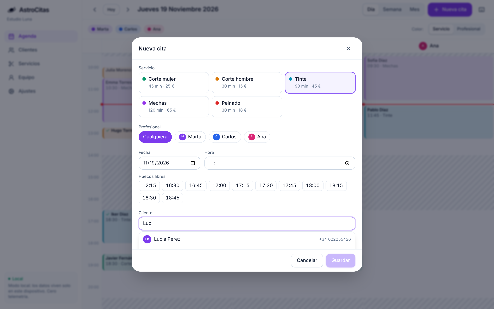
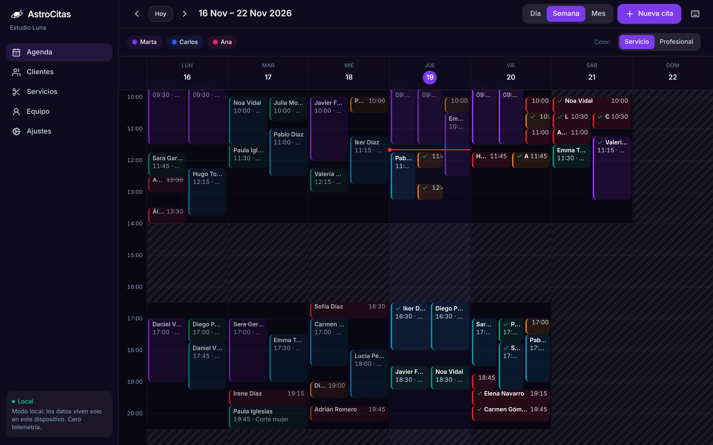
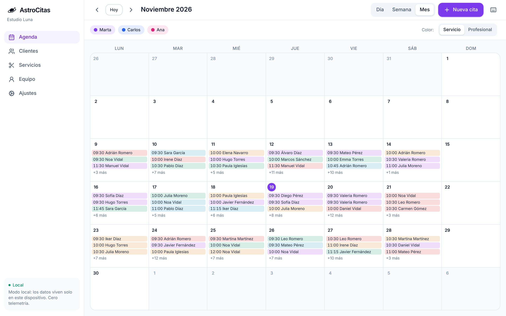
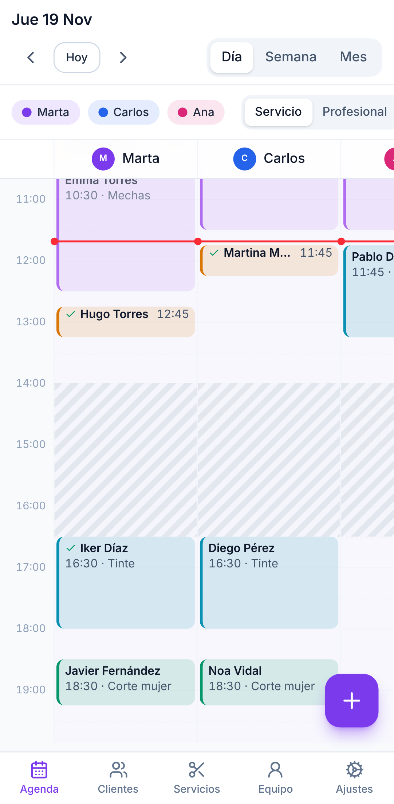
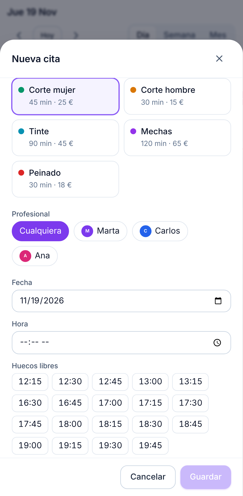
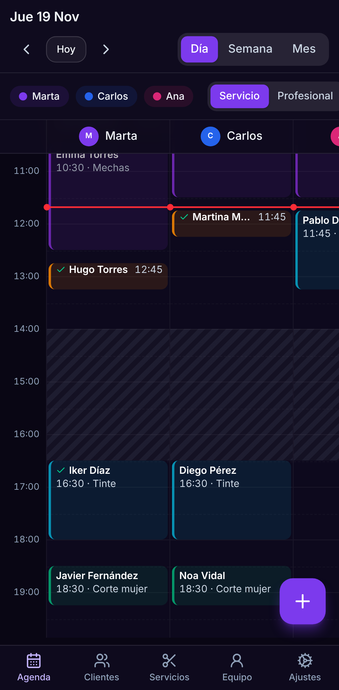

<p align="center">
  <picture>
    <source media="(prefers-color-scheme: dark)" srcset="assets/brand/logo-white.svg">
    
  </picture>
</p>

<p align="center">
  <strong>Agenda de citas con recordatorios para negocios de servicios y autónomos.</strong><br>
  Local-first · Open source · Sin cuentas · Tus datos, tu dispositivo, tu servidor.
</p>

<p align="center">
  <a href="LICENSE"></a>
  
  
</p>

<p align="center">
  
</p>

Peluquerías, barberías, clínicas, fisios, centros de estética, talleres, academias… AstroCitas es una
agenda **bonita, rápida y usable sin formación**. No hay servicio en la nube del autor, ni planes, ni pagos,
ni cuentas centrales. Funciona de dos formas con **el mismo código y la misma interfaz**:

- **A) Local** — instalas y funciona al instante, sin cuenta, sin internet y sin servidor. Los datos viven en tu dispositivo.
- **B) Autohospedado** — montas tu propio servidor con Docker y tus apps se conectan a él *(fase 4)*.

## Capturas

| Semana | Día por profesional |
|---|---|
|  |  |
| **Nueva cita en 3 toques** (servicio → hueco → cliente) | **Ficha de cliente** con historial y gasto |
|  |  |
| **Modo oscuro** | **Mes** |
|  |  |

<p align="center">
  
  
  
</p>

## Descargas

> Los binarios se publican automáticamente en [GitHub Releases](../../releases) al crear un tag `v*`
> (CI de releases: **fase 3**). Hasta entonces puedes usar la versión web o compilarla tú.

| Plataforma | Formato | Estado |
|---|---|---|
| 🌐 Web (PWA, instalable) | `astrocitas-web.zip` — cualquier hosting estático | ✅ disponible (compilar) |
| 🪟 Windows | `.msi`, `.exe` (NSIS), portable | fase 3 |
| 🍎 macOS | `.dmg` universal (Intel + Apple Silicon) | fase 3 |
| 🐧 Linux | AppImage, `.deb`, `.rpm` | fase 3 |
| 🤖 Android | `.apk` firmado, `.aab` | fase 3 |
| 📱 iOS | proyecto preparado (requiere cuenta Apple Developer) | fase 3 |
| 🐳 Servidor | `ghcr.io/…/astrocitas-server` (amd64/arm64) | fase 4 |

Cada release incluye `SHA256SUMS` y firmas para verificar la integridad.

## Instalación

### Modo A · Local (sin nada)

1. Abre la app (web o escritorio) y elige **«En este dispositivo»**.
2. Escribe el nombre de tu negocio, elige el tipo y quién atiende. Opcional: datos de ejemplo.
3. Listo. Sin registro, sin internet.

Tus datos se guardan en una base SQLite dentro del dispositivo (en la web, en el almacenamiento privado
del navegador, OPFS). Haz copias en **Ajustes → Tus datos → Descargar copia (.astrocitas)**.

### Modo B · Autohospedado *(fase 4)*

```bash
curl -fsSL https://raw.githubusercontent.com/<org>/astrocitas/main/install.sh | sh   # o:
docker compose up -d                                                                     # app + Caddy (HTTPS)
```

Después, en la app: **Conectar a mi servidor** → URL + usuario, y el asistente migra tus datos locales.
Guías para VPS, Raspberry Pi y NAS en `docs/` (fase 4).

## Qué hay ya (fase 1)

- ✅ Onboarding en 1 minuto con servicios sugeridos por tipo de negocio y datos de ejemplo opcionales.
- ✅ Calendario **día / semana / mes**, colores por profesional o servicio, **arrastrar y soltar** y
  redimensionar (ratón y táctil con pulsación larga), línea de hora actual, horario y ausencias sombreados.
- ✅ Citas en 3 toques con **huecos libres calculados** (duración + buffers, solapes, ausencias, festivos,
  zona horaria `Europe/Madrid` y cambios de hora), reprogramar, cancelar, no-show, cobrar, duplicar,
  **recurrentes** (semanal, quincenal, mensual) y **deshacer**.
- ✅ **Prevención de dobles reservas**: validación en `core` + *triggers* SQLite que lo impiden en el motor.
- ✅ Servicios (duración, precio, buffers antes/después, color, categoría).
- ✅ Profesionales con horario semanal en tramos, servicios asignados, vacaciones, festivos y bloqueos.
- ✅ Clientes: ficha, notas, etiquetas, cumpleaños, consentimientos RGPD, historial, total gastado,
  no-shows, exportar sus datos (RGPD), importar clientes desde CSV (exportable desde Excel).
- ✅ Copia completa `.astrocitas` (JSON) y restauración, exportación CSV de clientes y citas.
- ✅ Modo claro/oscuro, ES/EN, atajos de teclado (`N`, `T`, `D`/`W`/`M`, `←`/`→`, `/`, `?`), PWA instalable.
- ✅ Cero telemetría.

Hoja de ruta completa y diseño: **[docs/ARCHITECTURE.md](docs/ARCHITECTURE.md)**.

## Desarrollo

Requisitos: Node ≥ 22.13 y pnpm 10.

```bash
pnpm install
pnpm dev          # PWA en http://localhost:5173
pnpm test         # tests unitarios (core)
pnpm typecheck
pnpm build        # compila core, ui y la PWA (apps/web/dist)
pnpm e2e          # Playwright: flujo completo en escritorio y móvil
```

Estructura:

```
packages/core   lógica pura compartida (huecos, validación, SQL, migraciones)  ← local y servidor
packages/ui     interfaz React + Tailwind                                       ← Tauri y PWA
apps/web        PWA + SQLite WASM/OPFS
apps/client     Tauri 2 (fase 3)
apps/server     Fastify + Docker (fase 4)
```

## Privacidad

En modo local los datos **nunca** salen del dispositivo. AstroCitas no incluye analítica, telemetría ni
llamadas a servicios de terceros. Los mensajes a clientes se envían desde *tus* apps (WhatsApp, SMS,
email) o con *tus* credenciales en tu servidor.

## Licencia

[AGPL-3.0-or-later](LICENSE). Libre para usar, modificar y autohospedar, también con fines comerciales.
Si ofreces una versión modificada como servicio en red, debes publicar tus cambios: así nadie puede
convertir AstroCitas en un SaaS cerrado. Justificación completa en
[docs/ARCHITECTURE.md](docs/ARCHITECTURE.md#8-licencia-agpl-30-or-later-justificación).

Logo: planeta con órbita y luna, monocromo. Archivos en [`assets/brand/`](assets/brand).
