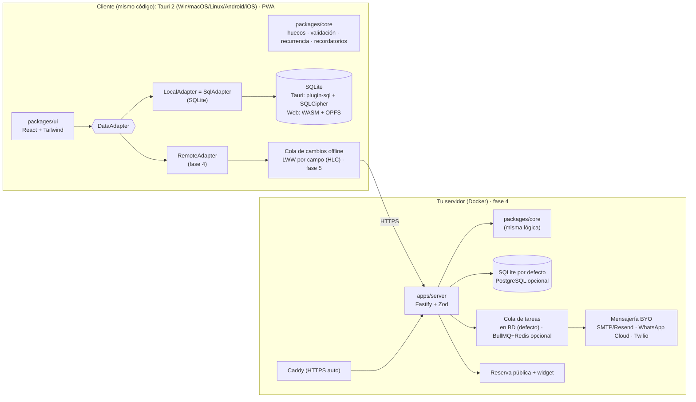
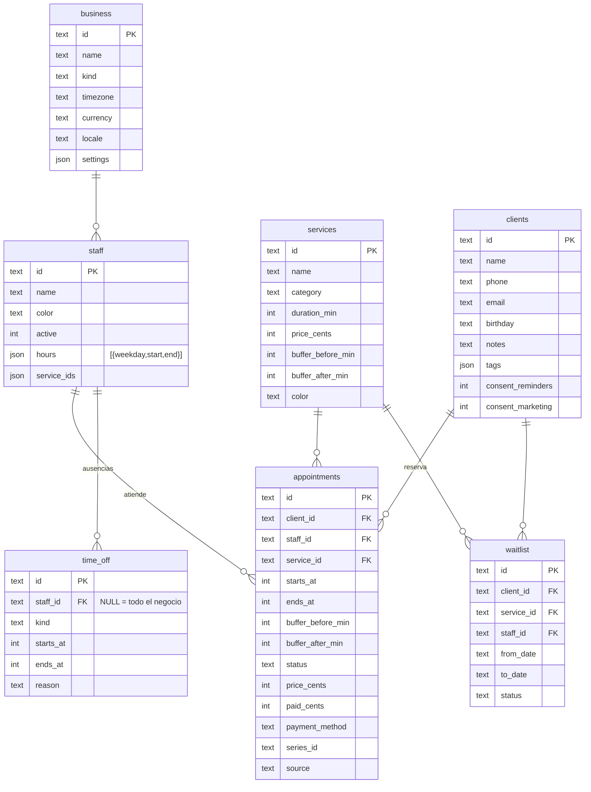

# Arquitectura de AstroCitas

AstroCitas es **local-first**: la app funciona entera en el dispositivo y el servidor propio es una
pieza **opcional** que se añade sin cambiar la interfaz. Un mismo código sirve a los dos modos:

| | **A) Local** | **B) Autohospedado** |
|---|---|---|
| Datos | SQLite en el dispositivo | SQLite o PostgreSQL en tu servidor |
| Cuenta | Ninguna | Usuario en *tu* servidor |
| Red | No necesita | Sí, contra tu servidor |
| Adaptador de datos | `SqlAdapter` (vía `LocalAdapter`) | `RemoteAdapter` (+ sincronización) |
| Recordatorios | Notificaciones locales + 1 toque (WhatsApp/SMS/email) + SMTP propio | Cola 24/7 con tus credenciales (SMTP/Resend, WhatsApp Cloud API, Twilio…) |
| Reserva de clientes | Modo solicitud (enlace/QR → WhatsApp/email) | Reserva online, widget embebible |

## 1. Vista general



**Principio clave:** toda regla de negocio (cálculo de huecos, conflictos, recurrencia, plantillas,
reglas de recordatorio, resolución de conflictos de sync) vive en `packages/core`, que es TypeScript puro
sin dependencias de plataforma. El cliente la ejecuta sin red y el servidor la reutiliza tal cual.

## 2. Árbol del monorepo

Leyenda: 🟢 compartido por los dos modos · 🔵 solo cliente · 🟠 solo servidor · ⚪ herramientas

```
astrocitas/
├── packages/
│   ├── core/                     🟢 lógica pura, sin I/O de plataforma
│   │   ├── src/types.ts          🟢 modelo + validación Zod
│   │   ├── src/time.ts           🟢 zona horaria / DST (Luxon)
│   │   ├── src/intervals.ts      🟢 álgebra de intervalos
│   │   ├── src/slots.ts          🟢 cálculo de huecos y conflictos
│   │   ├── src/recurrence.ts     🟢 citas recurrentes (hora de pared)
│   │   ├── src/adapter.ts        🟢 interfaz DataAdapter + errores
│   │   ├── src/backup.ts         🟢 formato .astrocitas, CSV
│   │   ├── src/presets.ts        🟢 onboarding, servicios tipo, datos demo
│   │   ├── src/sql/              🟢 driver SQL, migraciones, SqlAdapter (local y servidor-SQLite)
│   │   ├── src/reminders/        🟢 plantillas, reglas, enlaces wa.me/sms/mailto   (fase 2)
│   │   ├── src/sync/             🟢 HLC, LWW por campo, cola de cambios           (fase 5)
│   │   └── test/                 🟢 vitest (huecos, DST, recurrencia, repositorio)
│   └── ui/                       🔵 React + Tailwind (la usan Tauri y PWA)
│       ├── src/App.tsx           🔵 selector de modo, onboarding, layout
│       ├── src/calendar/         🔵 día/semana/mes, arrastrar y soltar, editor de cita
│       ├── src/screens/          🔵 clientes, servicios, equipo, ajustes
│       ├── src/components/       🔵 sistema de diseño, logo, toasts con deshacer
│       └── src/i18n.tsx          🔵 ES / EN
├── apps/
│   ├── web/                      🔵 PWA (Vite) + driver sqlite-wasm/OPFS en Worker
│   │   └── e2e/                  🔵 Playwright (escritorio + móvil)
│   ├── client/                   🔵 Tauri 2 (escritorio + Android, iOS preparado)  (fase 3)
│   └── server/                   🟠 Fastify + Zod + cola + reserva pública          (fase 4)
│       ├── Dockerfile            🟠 imagen multi-arch (amd64/arm64)
│       └── docker-compose.yml    🟠 app + Caddy (+ Postgres/Redis opcionales)
├── assets/brand/                 ⚪ logo B/N (SVG/PNG)
├── docs/                         ⚪ arquitectura, guías, capturas
├── scripts/                      ⚪ iconos, capturas, GIF de demo
└── .github/workflows/            ⚪ CI y releases
```

## 3. Esquema de base de datos (migración v1)

El **mismo esquema** se usa en el dispositivo y en el servidor con SQLite (PostgreSQL usará el
equivalente). Convenciones:

- `id TEXT` UUID generado en el dispositivo → no hay colisiones al sincronizar.
- Instantes en **epoch ms UTC** (`starts_at`, `ends_at`); la zona (`business.timezone`, por defecto
  `Europe/Madrid`) solo se aplica al calcular/mostrar → los cambios de hora no corrompen datos.
- Horarios semanales en **minutos locales** (0–1440), porque "abro a las 9:30" es hora de pared.
- Dinero en **céntimos** enteros.
- Toda fila tiene `created_at`, `updated_at` y `deleted_at` (**borrado lógico**: deshacer + tombstones para sync).



**Prevención de doble reserva en local:** dos *triggers* (`appointments_no_overlap_ins/upd`) abortan con
`ASTRO_OVERLAP` cualquier escritura que solape otra cita activa del mismo profesional, venga de donde venga.
En el servidor se añade una transacción `SERIALIZABLE`/`BEGIN IMMEDIATE` (y `EXCLUDE USING gist` en PostgreSQL).

### Tablas que llegan en fases siguientes (migraciones nuevas, nunca se editan las publicadas)

| Fase | Tablas | Para qué |
|---|---|---|
| 2 | `message_templates`, `reminder_rules`, `outbox_messages` | Plantillas con variables, reglas 24 h/2 h, registro de envíos 1-toque/SMTP |
| 4 | `users`, `sessions`, `audit_log`, `providers`, `jobs` | Auth (argon2, JWT+refresh, 2FA), roles, auditoría, credenciales BYO cifradas, cola en BD |
| 5 | `changes` (`entity, id, field, value, hlc, device`) + columna `hlc` | Sincronización incremental LWW por campo con relojes híbridos lógicos |
| 6 | `booking_requests`, `message_status` | Reserva pública, botones Confirmo/Cancelar/Cambiar, estado de entrega |
| 7 | `payments`, `loyalty_cards` | Cobros por cita, fidelidad |

## 4. Capa de datos

```ts
interface DataAdapter {            // packages/core/src/adapter.ts
  mode: 'local' | 'remote';
  getBusiness / saveBusiness
  listStaff / saveStaff
  listServices / saveService
  listClients / getClient / saveClient / clientStats
  listTimeOff / saveTimeOff
  listAppointments / getAppointment / saveAppointment / checkAppointment / createSeries
  listWaitlist / saveWaitlist
  remove / restore                 // borrado lógico + deshacer
  exportAll / importAll / wipe     // .astrocitas (JSON) — local ↔ servidor sin pérdidas
}
```

`SqlAdapter` implementa la interfaz sobre un `SqlDriver` mínimo (`exec`, `run`, `all`) con tres drivers:

| Driver | Dónde | Estado |
|---|---|---|
| sqlite-wasm + VFS `opfs-sahpool` en Worker | PWA (no requiere cabeceras COOP/COEP) | ✅ fase 1 |
| `node:sqlite` | tests, scripts, servidor | ✅ fase 1 |
| `tauri-plugin-sql` (+ SQLCipher) | escritorio / Android | fase 3 |

`SerialDb` serializa el acceso asíncrono y garantiza transacciones sin intercalado.

## 5. Cálculo de huecos

`computeSlots()` (puro, testeado):

1. Tramos laborables del profesional para el día local → UTC con Luxon (respeta días de 23/25 h).
2. Resta citas activas **con sus buffers** y ausencias (propias y del negocio).
3. Propone inicios alineados a la rejilla local (`slotStep`) donde cabe
   `[inicio − bufferAntes, inicio + duración + bufferDespués)`.
4. Filtra pasado/antelación mínima; agrupa por hora para "cualquier profesional".

`findConflicts()` distingue **errores** (solape real → nunca se guarda) de **avisos**
(buffer, fuera de horario, ausencia, servicio no asignado → se pueden forzar).

## 6. Sincronización (fase 5, diseño)

- Cada escritura local genera cambios por campo con marca **HLC** (`wallclock:counter:deviceId`).
- Cola offline persistente; envío incremental `POST /sync/push`, recepción `GET /sync/pull?since=hlc`.
- Resolución **last-write-wins por campo**: gana el HLC mayor; los borrados son tombstones (`deleted_at`).
- Las restricciones de negocio (solapes) se re-validan en el servidor; si un cambio offline choca, la cita
  se marca en conflicto y la UI lo muestra para resolverlo.
- Migración local → servidor: `exportAll()` + `importAll(mode: 'merge')` con verificación de recuento.

## 7. Seguridad y privacidad

- Modo local: nada sale del dispositivo; **cero telemetría**; sin dependencias de CDN en tiempo de ejecución.
- Cifrado en reposo con SQLCipher y contraseña opcional (Tauri, fase 2/3); copias `.astrocitas` cifrables.
- Servidor: argon2id, JWT de acceso corto + refresh rotatorio, 2FA TOTP, roles (propietario, recepción,
  profesional), auditoría, rate limiting y CAPTCHA (hCaptcha/Turnstile/ALTCHA autoalojado) en reserva pública.
- Releases firmadas (Tauri updater con clave minisign, APK firmado), SHA256SUMS y comprobación de integridad.

## 8. Licencia: AGPL-3.0-or-later (justificación)

Se elige **AGPL** en lugar de MIT porque el objetivo es que AstroCitas siga siendo de sus usuarios:

- Cualquiera puede usarla, modificarla y autohospedarla gratis, también comercialmente.
- Si alguien ofrece una versión modificada **como servicio en red** (un SaaS cerrado sobre este código),
  debe publicar sus cambios. MIT permitiría convertirlo en un producto propietario sin devolver nada.
- No afecta a quien solo la usa en su negocio ni a sus datos.

Contrapartida conocida: la App Store de Apple es incompatible con (A)GPL para *terceros* que redistribuyan;
el titular del copyright sí puede publicarla, y el proyecto acepta contribuciones bajo la misma licencia
(DCO) para conservar esa opción.

## 9. Plan por fases

| Fase | Contenido | Estado |
|---|---|---|
| 1 | core + SQLite local + calendario + servicios, profesionales y clientes | ✅ |
| 2 | Recordatorios locales, plantillas, envío 1-toque WhatsApp/SMS/email, SMTP propio, copias cifradas | ⏳ |
| 3 | Empaquetado Tauri 2 y CI de releases (escritorio + Android, iOS preparado, updater) | ⏳ |
| 4 | Servidor Fastify + Docker + Caddy + panel admin + "Conectar a mi servidor" | ⏳ |
| 5 | Sincronización y migración local ↔ servidor | ⏳ |
| 6 | Recordatorios automáticos con cola, reserva pública y widget | ⏳ |
| 7 | Informes, fidelidad, QR, .ics, pulido | ⏳ |
